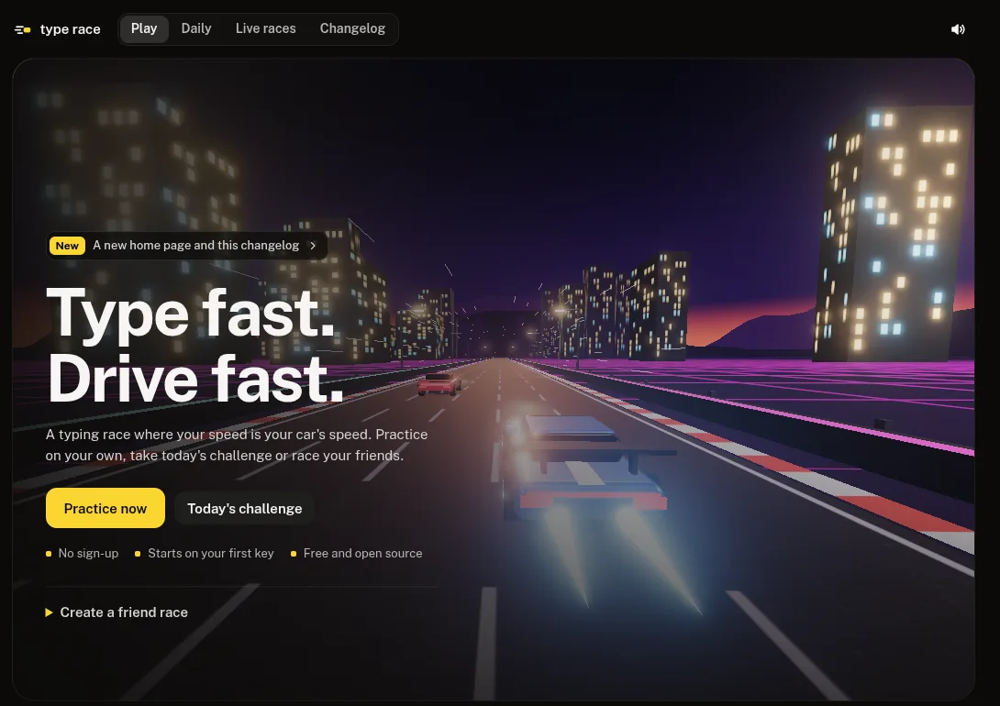
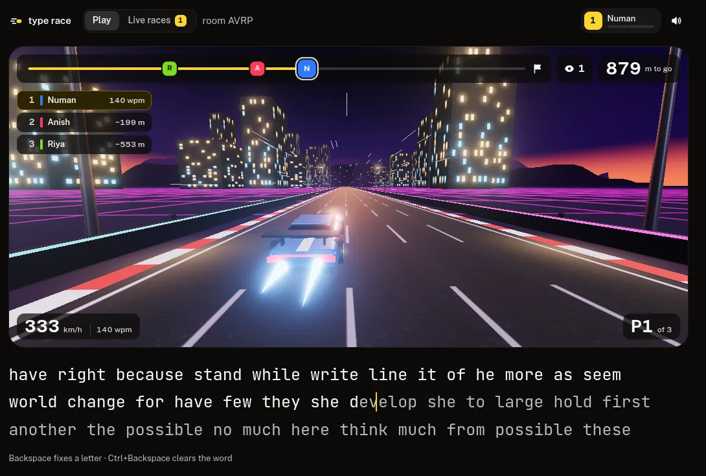
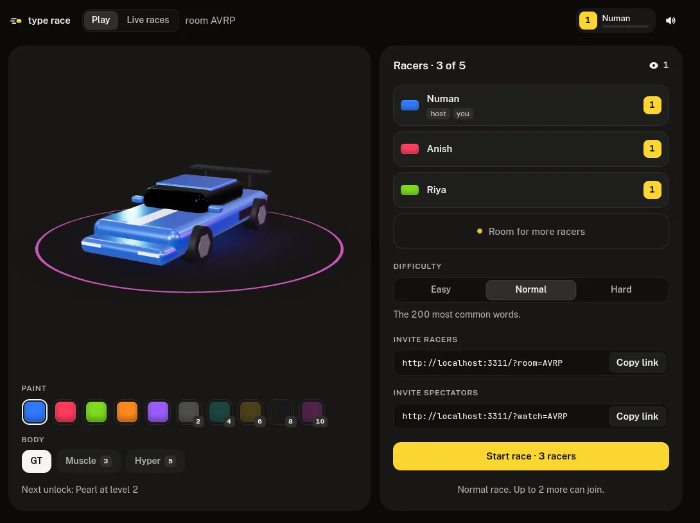
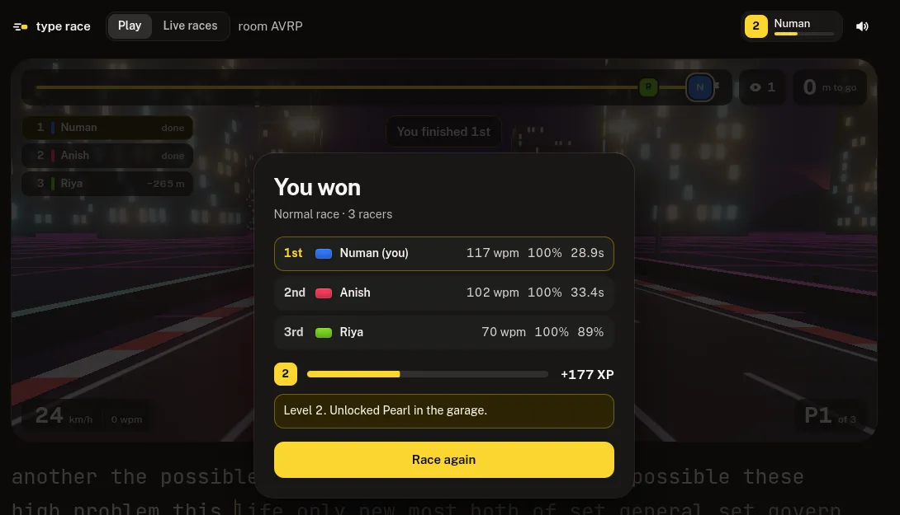
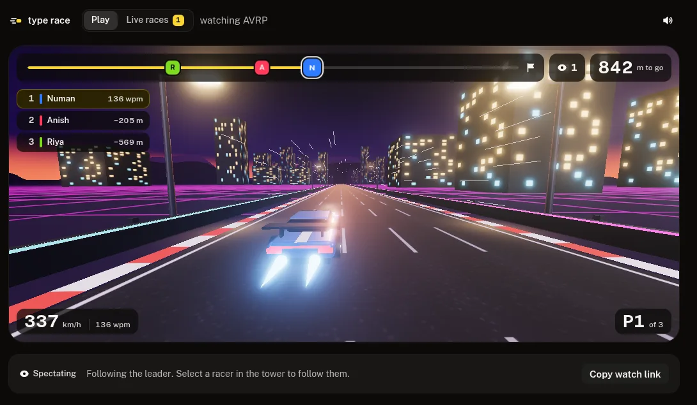
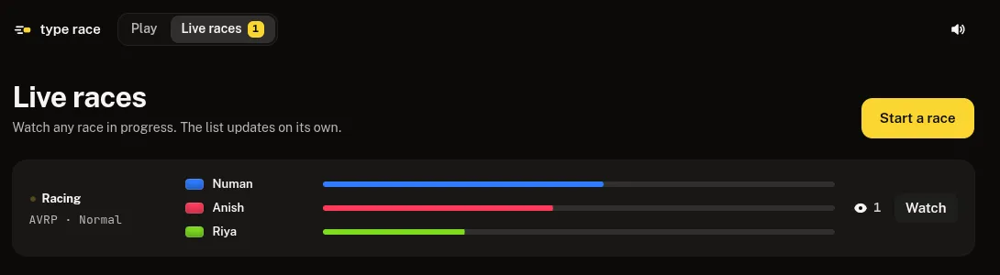

<div align="center">

# type race

**Type fast. Drive fast.**

A multiplayer typing race where your words per minute are your car's speed.
2 to 5 racers, the same words, one neon track.

[](https://github.com/Nuu-maan/type-race/actions/workflows/ci.yml)
[](LICENSE)
[](https://bun.sh)
[](https://threejs.org)
[](CONTRIBUTING.md)



</div>

## How a race works

1. Create a room and send the link to your friends.
2. Pick your paint and body in the garage while everyone joins.
3. The host starts once at least two racers are in. Everyone gets the same words.
4. Type. The faster and cleaner you type, the faster your car goes.

<p align="center">
  
</p>

## What's in the box

| | |
| --- | --- |
| **Typing that drives** | Your speed comes from your rolling WPM over the last 3 seconds. The car has momentum: it builds speed as you type and coasts down when you stop. |
| **Mistakes cost, they don't stop you** | Wrong letters show in red and the caret keeps going, like monkeytype. Each mistake slows your acceleration for a moment, and accuracy under 100% lowers your top speed. |
| **Nitro** | Eight clean words in a row give you a short boost. |
| **2 to 5 racers** | After the first car crosses the line, everyone else gets 15 seconds to finish. Podium places earn bonus XP. Rooms close after 10 minutes without activity. |
| **Spectating** | The Live races tab lists every race running. Watch from there or from a watch link, follow the leader or any racer you pick. |
| **Levels and a garage** | XP from every race. New paints and the Muscle and Hyper bodies unlock as you level. |
| **Difficulty** | Easy, Normal or Hard words. Mistakes cost more on harder races. |
| **Leaderboard** | Best WPM per difficulty, right on the landing page. |
| **Full screen and text size** | Race full screen with the words floating over the track, and pick small, medium or large text. Your choice is remembered. |
| **Sound** | A synthesized engine that climbs through the gears, key clicks, countdown, nitro and finish sounds, and a chime when someone joins your room. A mute button turns it all off. |

<table>
  <tr>
    <td width="50%"></td>
    <td width="50%"></td>
  </tr>
  <tr>
    <td align="center"><sub>Garage, racers and invite links</sub></td>
    <td align="center"><sub>Places, XP and unlocks</sub></td>
  </tr>
  <tr>
    <td width="50%"></td>
    <td width="50%"></td>
  </tr>
  <tr>
    <td align="center"><sub>Spectating</sub></td>
    <td align="center"><sub>Live races</sub></td>
  </tr>
</table>

## Run it

You need [Bun](https://bun.sh) 1.2.3 or newer.

```sh
bun install
bun run dev
```

Open http://localhost:3000, create a room and open the room link in a second tab to race yourself.

## Play with friends from your machine

Install [cloudflared](https://developers.cloudflare.com/cloudflared/downloads/), then:

```sh
bun run share
```

This starts the server and a Cloudflare quick tunnel and prints a public `https://….trycloudflare.com` link. Open it, create a room and send the room link to your friends. The link changes every time you run it and stops working when you press Ctrl+C.

## Deploy on Render

[](https://render.com/deploy?repo=https://github.com/Nuu-maan/type-race)

`render.yaml` sets up one free web service built from the `Dockerfile`. Rooms live in memory, so keep it at one instance. During the first Blueprint setup, Render asks for `DATABASE_URL`; use a Postgres connection string (the pooled one from Neon works well). Existing services must add it in the Render dashboard before syncing the updated Blueprint.

Render's free tier sleeps after 15 minutes without traffic. On Render the server requests its own public address (`RENDER_EXTERNAL_URL`, which Render sets) every 10 minutes, so it stays awake. One service running all month fits in the free tier's monthly hours.

Render checks `/api/health`, which verifies the database before a deploy receives traffic. A Render process without `DATABASE_URL` refuses to start so profiles, personal records, challenges, telemetry and leaderboards cannot silently fall back to disposable container storage.

## Controls

| Key | What it does |
| --- | --- |
| Letters | Type the next letter. Wrong ones show red and still move you on. |
| Space | Next word. Pressing it mid-word skips the rest of the word. |
| Backspace | Fix the last letter in the current word. |
| Ctrl+Backspace | Clear the current word. |
| Arrow keys | Turn the car in the garage. |

## Under the hood

- **Server**: one Bun process. It serves the page, runs every room over WebSockets and keeps profiles in Postgres (or a SQLite file locally). It is the source of truth: clients send keys, and the server runs the race at 20 ticks a second and broadcasts every car.
- **Client**: plain TypeScript and three.js, no framework. The car scene, garage and landing hero are WebGL, the rest is HTML and CSS.

```
src/
  shared/     game.ts (speed model, typing rules, places), words.ts, progress.ts (levels, XP, cars)
  server/     server.ts (rooms, race loop, API), db.ts, meta.ts (link previews, robots, sitemap), changelog.ts, share.ts
  client/     index.html, style.css, client.ts (screens and race flow), scene.ts (WebGL track, cars, garage),
              hud.ts, live.ts, garage.ts, leaderboard.ts, hero.ts, profile.ts, sound.ts, ui.ts
public/og/    link preview images
docs/         README screenshots
```

`shared` runs on both sides, so your own car reacts the moment you type while the server stays the referee. Tuning constants for the race sit at the top of `src/shared/game.ts`. Tests live next to the code they cover.

Profiles are keyed by an id each browser keeps. Local development and `bun run share` use `data/type-race.sqlite` by default; set `DB_PATH` to use another local file or `DATABASE_URL` to use Postgres. Render requires `DATABASE_URL`. Set `PORT` to use another port.

The project is linked to Neon. To work against your own copy of the data instead of production, create a branch and pull its connection string into `.env.local`, which Bun loads on its own:

```sh
neon checkout dev --create
```

## Checks

```sh
bun run check
bun test
```

## Changelog

Every update is written up in [CHANGELOG.md](CHANGELOG.md), which the site also shows at `/changelog`.

## Contributing

Bug reports, ideas and pull requests are welcome. Read [CONTRIBUTING.md](CONTRIBUTING.md) before you open one.

## License

[MIT](LICENSE) © Numan Khan
